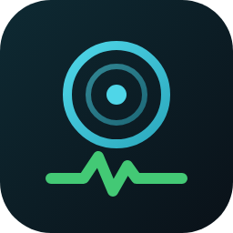

<p align="center">
  
</p>

<h1 align="center">Fn-SmartDisk</h1>

<p align="center">
  <strong>飞牛 fnOS 原生磁盘健康与冷备盘电源管理应用</strong><br>
  把 smartctl、lsblk、btrfs 的原始数据整理成清晰、可验证的硬盘健康档案。
</p>

<p align="center">
  
  
  
  
</p>

<p align="center">
  <a href="https://fn-smartdisk.pages.dev"><strong>在线介绍页</strong></a>
  &nbsp;·&nbsp;
  <a href="https://github.com/chanhuan1/Fn-SmartDisk"><strong>GitHub 项目</strong></a>
  &nbsp;·&nbsp;
  <a href="https://github.com/chanhuan1/Fn-SmartDisk/releases"><strong>下载 FPK</strong></a>
  &nbsp;·&nbsp;
  <a href="https://github.com/chanhuan1/Fn-SmartDisk/issues"><strong>问题反馈</strong></a>
</p>

---

## 项目概览

Fn-SmartDisk 是面向飞牛 fnOS 的原生 `.fpk` 应用，补齐官方磁盘面板之外的深度健康信息，并为冷备机械盘提供受保护的深度下线与手动唤醒能力。

| 方向 | 能力 |
|------|------|
| 磁盘健康 | SATA HDD / SSD、NVMe、USB 桥接盘的 SMART 属性、自检记录、错误日志、设备统计与温度历史 |
| 寿命识别 | NVMe 寿命、SATA SSD 厂商属性、三星官方 TBW 估算，并明确标注数据来源 |
| 链路诊断 | SATA 降速、PHY 错误、NVMe PCIe 链路、USB 桥接芯片、btrfs 池错误 |
| 电源控制 | 仅 SATA 机械盘支持深度下线与唤醒；系统盘、RAID 和读写中磁盘有多重保护 |
| 安全采集 | 机械盘先做无唤醒电源探测；休眠盘只有用户确认后才读取 SMART |
| 长期使用 | 磁盘备注、操作日志、下线恢复记录均按序列号持久化 |

## 功能说明

### 磁盘与 SMART

- 自动识别 SATA、NVMe、SCSI 和 USB 桥接设备。
- 中文 SMART 属性名、厂商专属属性和关键指标标记。
- 自检历史、ATA 错误日志、设备统计、SCT 温度历史和磁头加载计数。
- 盘体温度、通电时间、通电次数、累计写入量和介质健康评级。
- WWN / EUI-64、缓存、NCQ、转速、扇区、TRIM、固件和外形规格。

### 寿命、链路与存储

- NVMe 直接读取 `Percentage Used` 和完整健康日志。
- SATA SSD 结合主控、属性单位与厂商 TBW 数据估算剩余寿命。
- 识别群联、慧荣、三星、美光、海力士、铠侠、闪迪、金士顿等主控方案。
- 展示 SATA / NVMe 链路协商速率及降速风险。
- 展示分区、RAID、LVM、文件系统和挂载点的完整存储链。
- 汇总 btrfs 读写、校验和、代际错误，作为静默损坏的早期信号。

### 冷备盘电源控制

| 操作 | 执行流程 | 适用条件 |
|------|----------|----------|
| 深度下线 | `sync` → 懒卸载挂载卷 → 停转 → 内核 `device offline` | 仅 SATA 机械盘，且不是系统盘 |
| 手动唤醒 | 内核 `running` → 等待设备 → 重扫总线 → 按 UUID 补挂载 | 已由本应用深度下线的磁盘 |

保护规则：

- 系统盘禁止电源操作。
- md RAID 成员盘必须单独确认阵列降级风险。
- 正在读写的磁盘必须单独确认数据风险。
- 恢复数据或下线状态无法持久化时，拒绝继续执行危险操作。
- 唤醒后逐项检查原有挂载卷，不把部分恢复误报为成功。

## 安装

### 方式一：手动安装

1. 打开 GitHub Releases，下载最新的 `SmartDisk.fpk`。
2. 进入 fnOS 应用中心，选择「手动安装」。
3. 上传 FPK，安装完成后从桌面打开「磁盘高级管理」。

默认通过 fnOS 统一网关 `/app/SmartDisk` 访问，也可使用独立端口 `8315` 直连。

> [!WARNING]
> SMART 数据采集是只读操作。电源控制会执行停转、卸载和内核上下线动作，仅适用于已经确认可以离线的冷备盘。

## 本地开发

环境要求：

- Go 1.24+
- Node.js 18+
- `fnpack`

前端：

```bash
cd web
npm ci
npm run typecheck
npm run build
```

后端测试：

```bash
cd server
go test -race ./...
go vet ./...
```

本地 mock 服务：

```bash
SMARTDISK_MOCK_DIR=./mock go run .
```

构建 FPK：

```bash
GO=/path/to/go scripts/build.sh
```

产物位于 `SmartDisk/SmartDisk.fpk`。

## 项目结构

```text
.
├── server/       Go API、采集器、SMART 解析与电源状态机
├── web/          Vue 3 + Vite 管理面板
├── SmartDisk/    fnOS fpk 骨架与最终安装包
├── site/         Cloudflare Pages 在线介绍页
├── scripts/      开发与打包脚本
└── tools/        截图、检查与辅助工具
```

## 路线图

- [ ] SMART 短自检 / 长自检触发与进度
- [ ] 定时巡检与异常通知
- [ ] 温度、寿命和错误计数历史曲线
- [ ] ARM64 架构支持

## 参与项目

- 提交问题：<https://github.com/chanhuan1/Fn-SmartDisk/issues>
- 查看版本：<https://github.com/chanhuan1/Fn-SmartDisk/releases>
- 在线介绍页：<https://fn-smartdisk.pages.dev>

## License

MIT
